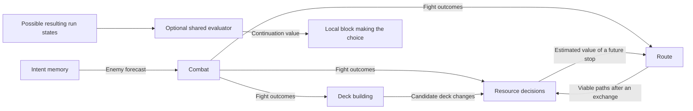

# Notes on running the game

## 25 Nov 2026 — Which decisions would I make again?

Headbutt gives me a useful place to start. The game knows what the card does. I still have to decide which slime to hit and which card I want next. Three floors later, I might have to decide whether Headbutt is worth buying at all. Which of my earlier choices carry over to that decision?

### The decision tree

Follow the last branch at each level to continue. “Built” means that path exists in combat. “Proposed” marks a choice for the full-run player. The levels show which choices depend on earlier ones. Some of the experiments happened in a different order.

```text
Goal: win more runs; measure how far losses get
├─ Start with mixed characters, difficulties, or mods
└─ 1. Start with vanilla A20 Ironclad and player-visible information [built]
   ├─ Make a learned reader infer mechanics from text or combat memory
   ├─ Give the policy IDs alone, or IDs plus printed text
   └─ 2. Supply known card rules and facts; learn which play is valuable [built]
      ├─ Flatten every slot and pile into a fixed state vector
      └─ 3. Give each visible object its own row and reuse encoders [built]
         ├─ Pool the rows into a summary
         ├─ Give each candidate its own cross-attention query
         └─ 4. Let objects interact through self-attention [built]
            ├─ Fixed output per action ID, or pick a card and a target separately
            └─ 5. Score each legal candidate under the current prompt [built]
               ├─ Train only on immediate damage or which attack wins
               └─ 6. Train on complete fights and their outcomes [built]
                  ├─ Separate combat, deck, route, and resource policies
                  ├─ Share the encoder and specialize the scoring heads
                  └─ 7. Start with one shared policy across screens [proposed]
                     ├─ Perfect each screen's strategy in isolation first
                     └─ 8. Connect the screens, train on runs, then
                        change one component or connection at a time [proposed]
```

One tooling choice cuts across the tree. I started with a bridge to the installed game and a recorder so I could inspect what the player saw. For repeated training fights I used a simulator, then integrated the RL fork for its public observations, legal choices, and game transitions. I can keep the live bridge as a check if a simulated interaction looks wrong. Switching the simulator doesn't require choosing a different neural network. [Fork integration](experiments/headbutt/README.md)

### Why I took each turn, and what could change it

| Level | Why this branch | When I'd reopen it |
|---|---|---|
| 1 · Scope | Fixing the character and difficulty gives me an interpretable comparison when I change the model. I want decisions a player could make, so the agent sees the current intent and public pile contents. The simulator resolves hidden draws. | If I start claiming transfer, freeze the policy and evaluate a new character or difficulty separately. I can also test a forecast learned from public enemy history while keeping future moves hidden. |
| 2 · Card meaning | IDs plus text improved a held-out attack test. Supplying parsed damage and hit count raised correct preference switches from **214/384 to 282/384**, even though average damage error increased. For vanilla play, the rules are available and the interesting uncertainty is which action to take. The fork supplies facts and executes effects; our catalogue also describes effects the fact table omits. | A mod with an unfamiliar effect changes the problem. That's when I'd compare text, memory, and catalogue fallback on unseen cards. I'd keep the original card effect and its observed outcome as separate prediction targets. [Card experiments](experiments/card_text/README.md) · [Memory experiment](experiments/memory/README.md) |
| 3 · State shape | Two copies of Strike can use the same encoder in different slots. I can represent a changing number of enemies, hand cards, and discard cards without choosing a permanent input column for each one. Zone and target identity still matter. | Revisit how piles are represented if large decks make inference expensive. Measure decision time and whether a compressed representation loses pairs or quantities the policy needs. |
| 4 · Interaction | Self-attention reads the fight once. Headbutt's row can already contain information about the discard pile, and the scorer still gets the particular enemy row for each possible target. | Try action-specific cross-attention if replay analysis repeatedly finds a target choice depends on a third object the scorer misses. Compare matched fights, training budget, and inference time. I haven't run that comparison. [Attention notes](MODEL.md) |
| 5 · Actions | “Headbutt on the left slime” is one legal move. After damage resolves, “put this Strike on top” is a new decision with a new state. An offered card can also be a candidate even though it was never in my hand. Keeping the fork's action ID alongside the candidate lets the game execute the choice directly. | This is an earlier choice I **already revised**. The Headbutt-specific string interface worked, but Discovery exposed its dependence on a particular source pile. I'd keep the public-state, prompt, and candidate contract even if I split the policy later. [Headbutt test](experiments/headbutt/README.md) · [Current interface](battle/policy.py) |
| 6 · Feedback | Exact damage helped diagnose whether the model understood an attack. It couldn't tell me whether to block. The earlier combat policy trained on victory plus remaining HP fraction. On 64 held-out low-HP starts it won **56**, versus **51** for attack-first. The later fork policy completed a fight with Headbutt and Discovery. Those are separate results. | **Reopen before full-run training.** A local fight reward can favor spending the last potion for HP even when the next elite makes saving it worthwhile. Keep combat HP as a diagnostic. Choose the full-run win condition first; Act 3 and the Heart are still open. [Combat results and replay](experiments/combat/README.md) |
| 7 · Sharing | A potion has the same identity in the shop and in combat. One policy can learn from both contexts without requiring me to invent a numerical “value of this potion” message between two networks. Combat has demonstrated multiple prompt types. The current runner still picks pre-combat options by script and stops after the first fight. | Keep the separate-head branch available. If joint training repeatedly hurts an existing decision type, compare a shared scorer with specialized heads using the same observations, training budget, and held-out run seeds. Split only if the change helps run outcomes. A shared evaluator is another independent option if delayed feedback proves a problem. [Current runner](experiments/combat/fork_battle.py) |
| 8 · Improvement | My idea is to complete the components, train them together, then improve one component or connection at a time. “Complete” here means each screen can expose its state and execute every legal choice it offers. The first full-run policy gives me a common reference for judging upgrades. | Freeze the reference, replace one piece, and replay the same evaluation seeds. Then fine-tune the pieces together to see whether they can use the change. Score wins and progress on losses. Use individual decisions from replays to investigate failures. |

**Where I'd revise the plan today.** I'd carry the candidate interface forward, reopen the reward at the fight-to-run boundary, and leave the encoder trainable in the design. Freezing it for the 32-fight fork experiment let me isolate the scorer change. Once the model has to read a map or a shop, I'd compare frozen and trainable encoders. The shared full-run policy is my preferred next branch; its advantage over separate heads is still an open experiment.

## 18 Nov 2026 — Who decides whether a potion is worth buying?

I started with two interactions: HP trades against potions, and spending gold changes almost every other option in a run. A potion can be worth buying because it opens an elite route I would otherwise avoid. That's the interaction I want my local models to capture. Here's the current sketch for A20 Ironclad. A block is a responsibility for now; I haven't committed to one neural network per block.

| Local block | Decision it owns | Information it can offer another block |
|---|---|---|
| Combat | Play a card on a target, use a potion, or end the turn. Its intent memory uses observed enemy behavior and the current-turn intent. | Given a deck, resources, and a possible encounter, estimate a distribution of outcomes: death or survival, remaining HP, potions, and other persistent changes. Initially this could come from repeated fights. |
| Deck building | Pick or skip a free card reward. | For a shop or campfire, identify promising purchases, removals, or upgrades and explain their expected effect on relevant fights. |
| Route | Choose the next accessible node from the visible map. | Estimate which paths become viable after a purchase, rest, or reward. At an unrevealed node, consider possible encounters or offers using information available to the player. |
| Resource decisions | Choose a legal exchange at a shop, campfire, event, or competing inventory reward. | Commit the chosen exchange to the run state. Before visiting a node, the route block can also use an estimate of what a shop or rest opportunity might be worth. |

The blocks read the same player-visible run state: HP, deck, relics, potion slots, gold, map, current scene, and available choices. In a shop, the deck block can recommend a removal while the resource block decides whether to pay for it. On the map, the route block owns the move. That gives me one decision maker per choice. Estimates passed back and forth can come from recorded outcomes or a previous model version; I don't need two blocks calling each other indefinitely.



**Where a global evaluator might help.** I can ask one shared evaluator how often the current player goes on to win from each possible state. The local block still chooses the action. Buying a potion leaves me in the shop with less gold, a changed inventory, and possibly another purchase available. Leaving takes me to a different decision. In combat I'd evaluate each possible post-fight state separately and then average the values by probability. A fight with a chance of death can look deceptively safe if I average HP first.

Actual trajectories give feedback in the other direction. I can link a shop decision to potion use, losses in the next fight, later spending opportunities, and eventually the run outcome. One win after a purchase doesn't tell me what caused it. To compare buying and leaving, I could branch from the same shop and hold the downstream policy versions fixed while allowing different routes and plays. A full-run evaluator would learn from player-visible snapshots paired with eventual wins and losses. As the player improves, I'd need fresh data. Act 3 versus Heart remains an open choice for the full-run win label.

**Where I'd start.** First I'd draw up a small bank of legal combat starts with different enemies, related deck variants, and potions. I'd reserve an enemy/deck pairing for evaluation. One fight is enough to debug the connection; a player tested only on that one fight wouldn't answer my generalization question.

The first interaction I'd test is carrying one potion across two fights. I can run the same version of the combat player from the same first-fight snapshot, use the potion at a specified legal decision in one branch, and keep it at that decision in the other. After that, let the same policy choose freely. Record both fight outcomes, when the potion is used, and survival through fight two across repeated trials. This gives the value interface an observable short-horizon target before I have a trained evaluator or full-run labels.

If that works, I'd add a shop with a buy/leave choice and a route fork. I could then check whether the purchase changes the route the player can afford to take. The designs of the individual networks, separate versus shared parameters, and whether a learned global evaluator improves on measured outcomes are all open. No experiments have run yet. The earlier [model notes](MODEL.md) and [reading notes](READING.md) keep the alternatives that led here.

## 18 Nov 2026 — What I'd want to see after a loss

I want the AI to win more runs and, when it loses, to get further. One starting point suggested in the discussion was Ironclad on Ascension 0, counting a win when it beats the Act 3 boss. If I use that setup, I'll save the game version and settings alongside the result so I can repeat the comparison.

My MathCard game already handled move legality and used 37 action slots. One idea I can borrow is having the game tell the policy which moves are available. During a fight that might include playing the same card on either of two enemies. At a reward screen it might be three cards and Skip. The policy could pick from the list in both cases without inheriting the old game's action numbers.

Before settling on that interface, I'd like to watch one actual card play and one reward choice. Does the game ask for the card first and the target second? Can I cancel in between? A decision ID might help here: if a response arrives after the game has moved on, the runner could discard it instead of accidentally playing another card.

When I replay a loss, I'd like to pause before a bad move and see what the AI knew, what it could have done, and what it picked. The runner can save the seed to reproduce the run. The policy should only see draw order when the player can see it, and an event node on the map shouldn't give away the event outcome. The policy's memory should start fresh each run.

A rule-based player would let me check all of that before training. Later I could compare two policies on the same seeds, keep a separate set for final evaluation, and record wins and floors reached along with the policy version and settings. I'd log interrupted runs separately so I can tell a broken adapter from a lost fight. The [model notes](MODEL.md) pick up the architecture question I originally wanted to discuss.
