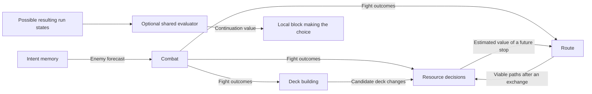

# Notes on running the game

## 18 Nov 2026 — Who decides whether a potion is worth buying?

I started with two interactions: HP trades against potions, and spending gold changes almost every other option in a run. A potion can be worth buying because it opens an elite route I would otherwise avoid. That's the interaction I want my local models to capture. Here's the current sketch for A20 Ironclad. A block is a responsibility for now; I haven't committed to one neural network per block.

| Local block | Decision it owns | Information it can offer another block |
|---|---|---|
| Combat | Play a card on a target, use a potion, or end the turn. Its intent memory uses observed enemy behavior and the current-turn intent. | Given a deck, resources, and a possible encounter, estimate a distribution of outcomes: death or survival, remaining HP, potions, and other persistent changes. Initially this could come from repeated fights. |
| Deck building | Pick or skip a free card reward. | For a shop or campfire, identify promising purchases, removals, or upgrades and explain their expected effect on relevant fights. |
| Route | Choose the next accessible node from the visible map. | Estimate which paths become viable after a purchase, rest, or reward. At an unrevealed node, consider possible encounters or offers using information available to the player. |
| Resource decisions | Choose a legal exchange at a shop, campfire, event, or competing inventory reward. | Commit the chosen exchange to the run state. Before visiting a node, the route block can also use an estimate of what a shop or rest opportunity might be worth. |

The blocks read the same player-visible run state: HP, deck, relics, potion slots, gold, map, current scene, and available choices. In a shop, the deck block can recommend a removal while the resource block decides whether to pay for it. On the map, the route block owns the move. That gives me one decision maker per choice. Estimates passed back and forth can come from recorded outcomes or a previous model version; I don't need two blocks calling each other indefinitely.

**Where a global evaluator might help.** I can ask one shared evaluator how often the current player goes on to win from each possible state. The local block still chooses the action. Buying a potion leaves me in the shop with less gold, a changed inventory, and possibly another purchase available. Leaving takes me to a different decision. In combat I'd evaluate each possible post-fight state separately and then average the values by probability. A fight with a chance of death can look deceptively safe if I average HP first.

Actual trajectories give feedback in the other direction. I can link a shop decision to potion use, losses in the next fight, later spending opportunities, and eventually the run outcome. One win after a purchase doesn't tell me what caused it. To compare buying and leaving, I could branch from the same shop and hold the downstream policy versions fixed while allowing different routes and plays. A full-run evaluator would learn from player-visible snapshots paired with eventual wins and losses. As the player improves, I'd need fresh data. Act 3 versus Heart remains an open choice for the full-run win label.

**Where I'd start.** First I'd draw up a small bank of legal combat starts with different enemies, related deck variants, and potions. I'd reserve an enemy/deck pairing for evaluation. One fight is enough to debug the connection; a player tested only on that one fight wouldn't answer my generalization question.

The first interaction I'd test is carrying one potion across two fights. I can run the same version of the combat player from the same first-fight snapshot, use the potion at a specified legal decision in one branch, and keep it at that decision in the other. After that, let the same policy choose freely. Record both fight outcomes, when the potion is used, and survival through fight two across repeated trials. This gives the value interface an observable short-horizon target before I have a trained evaluator or full-run labels.

If that works, I'd add a shop with a buy/leave choice and a route fork. I could then check whether the purchase changes the route the player can afford to take. The designs of the individual networks, separate versus shared parameters, and whether a learned global evaluator improves on measured outcomes are all open. No experiments have run yet. The earlier [model notes](MODEL.md) and [reading notes](READING.md) keep the alternatives that led here.

## 18 Nov 2026 — What I'd want to see after a loss

I want the AI to win more runs and, when it loses, to get further. One starting point suggested in the discussion was Ironclad on Ascension 0, counting a win when it beats the Act 3 boss. If I use that setup, I'll save the game version and settings alongside the result so I can repeat the comparison.

My MathCard game already handled move legality and used 37 action slots. One idea I can borrow is having the game tell the policy which moves are available. During a fight that might include playing the same card on either of two enemies. At a reward screen it might be three cards and Skip. The policy could pick from the list in both cases without inheriting the old game's action numbers.

Before settling on that interface, I'd like to watch one actual card play and one reward choice. Does the game ask for the card first and the target second? Can I cancel in between? A decision ID might help here: if a response arrives after the game has moved on, the runner could discard it instead of accidentally playing another card.

When I replay a loss, I'd like to pause before a bad move and see what the AI knew, what it could have done, and what it picked. The runner can save the seed to reproduce the run. The policy should only see draw order when the player can see it, and an event node on the map shouldn't give away the event outcome. The policy's memory should start fresh each run.

A rule-based player would let me check all of that before training. Later I could compare two policies on the same seeds, keep a separate set for final evaluation, and record wins and floors reached along with the policy version and settings. I'd log interrupted runs separately so I can tell a broken adapter from a lost fight. The [model notes](MODEL.md) pick up the architecture question I originally wanted to discuss.
